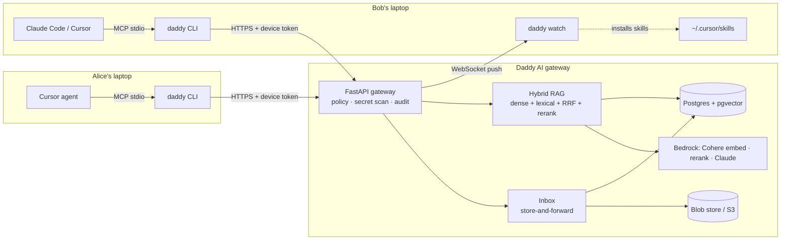

# Daddy AI

**One brain for the whole team's AI agents.** Every teammate keeps using their own agent (Cursor,
Claude Code, …). Those agents become *family members* that ask **Daddy AI**, the central brain, about
the team's projects, and send files, skills and messages to each other through it. Daddy AI decides
what each agent may see and send, blocks secrets, and records everything in one audit log.



## What it does

| Agent asks… | Daddy AI… |
| --- | --- |
| "How do we deploy?" | answers from the project's code, docs and notes, citing `path:lines`, and only from projects the user belongs to |
| "What's the capital of France?" | refuses with *"Not in project knowledge."* (a relevance threshold, so it never guesses) |
| "Send my deploy skill to Bob" | checks both are project members, scans for secrets, puts it in Bob's inbox; Bob's `daddy watch` installs it into Cursor *and* Claude Code |
| "Send `.env` to Bob" | blocks it on the laptop: it never leaves the computer, and the attempt is audited |
| "Remember: we chose pgvector" | saves a note every teammate's agent can find immediately |

Controls for the Agent Harness track:
- **Identity**: one revocable token per device, and the agent's name (Cursor, Claude) is recorded per call.
- **Policy**: owner, member and viewer roles per project. The permission join sits inside the retrieval SQL, so another project's chunks are never even scored.
- **Secret scanning**: runs on the laptop before upload or send, again on the server, and optionally through a Bedrock Guardrail.
- **Prompt guard**: a Cursor `beforeSubmitPrompt` hook blocks prompts containing secrets before they reach any model.
- **Audit**: every allow, deny and error with latency, streamed live to admins (`daddy audit -f`).

The RAG pipeline follows the practices evaluated in our thesis:
- Hybrid dense plus lexical search with Reciprocal Rank Fusion (k=60, weights 0.7/0.3).
- A pool of 20 candidates, cross-encoder reranked to the top 5.
- A refusal threshold checked before calling the LLM.
- Follow-up question rewriting.
- A grounded prompt with numbered sources and prompt-injection rules.
- Structure-aware chunks that carry their file, heading and line range.

## Quick start (local, no AWS needed)

Requirements: Docker and [uv](https://docs.astral.sh/uv/).

```bash
docker compose up -d                 # Postgres 17 + pgvector on :5433
uv sync
uv run daddy-server                  # gateway on http://127.0.0.1:8787 (keep running)
```

In another terminal, the first person creates the family:

```bash
uv run daddy init                    # asks for family name, your name, email
uv run daddy project create "My App"
uv run daddy ingest .                # or: uv run daddy github owner/repo
uv run daddy ask "How is the project structured?"
uv run daddy invite bob@example.com --name Bob --project my-app   # prints Bob's join command
```

Each teammate runs:

```bash
uv tool install ./packages/cli       # installs the `daddy` command
daddy join inv_… --server http://<gateway-host>:8787
daddy connect cursor                 # or: daddy connect claude
daddy watch                          # optional: live notifications + automatic skill install
```

`daddy connect cursor` adds the `daddy` MCP server to `~/.cursor/mcp.json`. Use
`--project-dir .` to connect a single project, which also adds an always-on agent rule, and add
`--hooks` to install the prompt guard and activity hooks (into the same `.cursor` folder). Restart Cursor, then ask the agent
**"Daddy, who am I?"**. It calls `whoami` and shows your family, projects and inbox. Every later
call shows up in `daddy audit`.

## Dashboard

```bash
uv run daddy dashboard
```

This opens **the family ledger** in your browser with a one-time login link that expires after two minutes, so the CLI's token never reaches the browser.

- **Figures:** questions answered, deliveries, actions stopped and active agents over the last 24 hours.
- **Family tree:** Daddy AI at the root, then each member, their computers, and the agents seen on each computer. Admins can revoke a computer from here.
- **Ledger:** a live, filterable record of every agent action, with blocked actions shown in red and the reason for each block.
- **Projects and house rules:** what each project holds, and the policies enforced on every call.

## Models

Everything runs locally by default:
- hashed n-gram embeddings
- a lexical reranker
- an extractive answer that quotes the top passages, or Ollama if you set `DADDY_LLM_PROVIDER=ollama`

With AWS credentials, switch to Bedrock in `.env` (see `.env.example`):

```bash
DADDY_EMBEDDING_PROVIDER=bedrock     # Cohere Embed Multilingual v3 (1024-d)
DADDY_RERANK_PROVIDER=bedrock        # Cohere Rerank 3.5 via Bedrock Rerank
DADDY_LLM_PROVIDER=bedrock           # Claude via Converse
DADDY_S3_BUCKET=…                    # artifacts and raw files in S3 (SSE-KMS)
DADDY_GUARDRAIL_ID=…                 # optional Bedrock Guardrail on everything shared
```

Changing the embedding model requires re-ingesting, because vectors from different models are not comparable.
The AWS setup is in [`docs/AWS.md`](docs/AWS.md) (what to ask, the IAM policy) and [`deploy/README.md`](deploy/README.md) (step-by-step deployment).

## Development

```bash
uv run pytest                        # unit tests + full API flow on a throwaway database
uv run ruff check packages scripts
uv run python scripts/mcp_smoke.py   # talk to `daddy mcp` exactly like Cursor does
docker compose down -v               # wipe all data
```

| Package | Contents |
| --- | --- |
| `packages/server` | FastAPI gateway: auth, policy, audit, ingestion and chunking, hybrid retrieval, delivery, WebSocket events, providers |
| `packages/cli` | `daddy` CLI: onboarding, ingestion, inbox, `watch`, `connect`, the local MCP server and Cursor hooks |
| `packages/common` | Secret scanner and ignore rules shared by the laptop and the server |
